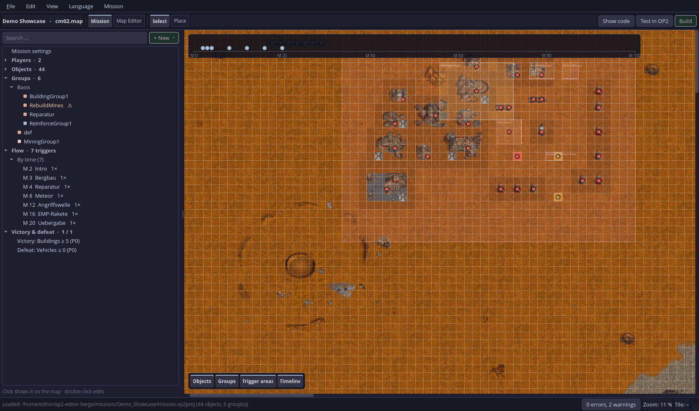
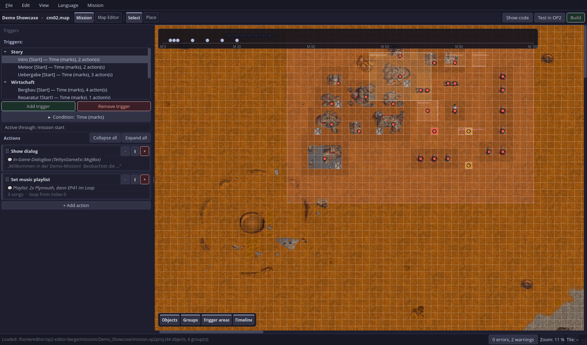
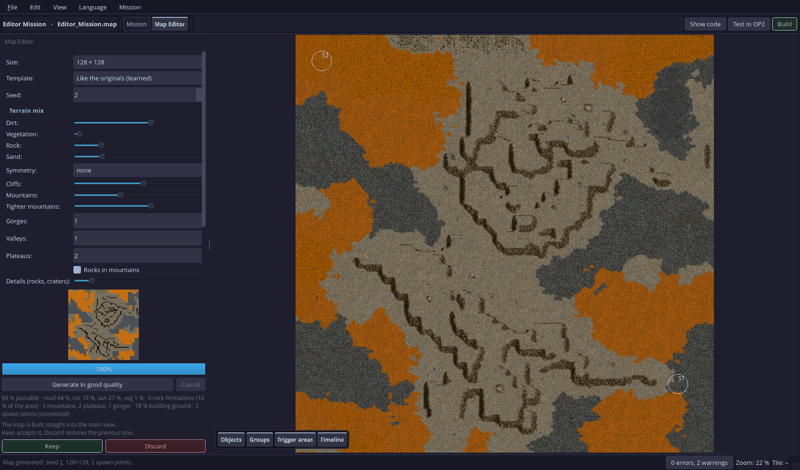
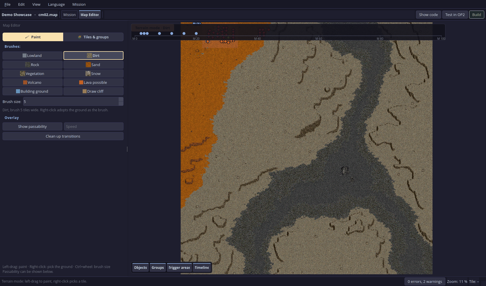

# OP2MissionBuilder

> **Alpha release.** Expect rough edges. Feedback and bug reports welcome.

A visual mission editor for *Outpost 2: Divided Destiny*. Design missions by clicking, generate native C++ source code, compile it to a 32-bit DLL that Outpost 2 loads directly.

Built against the classic [OP2MissionSDK](https://github.com/OutpostUniverse/OP2MissionSDK) (Outpost2DLL + OP2Helper + HFL) maintained by Outpost Universe.



**Feature manual:** [English](EDITOR_DOCS.md) · [Deutsch](EDITOR_DOKU.md) — walk-through of the panels, dialogs and action types.

Download: [Releases](https://github.com/fefi-byte/op2-codegen-editor/releases) (Windows ZIP, no Python needed) · Changes: [CHANGELOG.md](CHANGELOG.md).

## What's in the editor

### Missions

- **Mission outline** — players, objects, groups, triggers and victory/defeat in one tree; click shows it on the map, double-click edits it
- **Visual placement** — buildings, vehicles with facing, mining beacons, walls and tubes on the real tile map, drawn with the game's own graphics in the player colour
- **Players** — up to 6 players, human or AI, per-player resources, tech level, pre-researched techs
- **Groups** — BuildingGroup / ReinforceGroup / FightGroup / MiningGroup, each with its own roster and behaviour; areas can be dragged on the map
- **Triggers and actions** — conditions (time, count, resource, point, rect, …), 15+ action kinds, nested if/then/else, loops, branches by difficulty, own actions from the action designer, a timeline of time triggers
- **Self-healing groups** — mission-wide watchdog that re-attaches rebuilt buildings/mines/smelters to their group automatically
- **op2-ki opponent (optional)** — an AI player can be handed to [op2-ki](https://github.com/fefi-byte/op2-ki), a separate project: it builds its colony, researches and fights on its own (multiplayer opponent or mission roles, with script and attack commands from triggers). The editor only links it in, see [docs/op2-ki.md](docs/op2-ki.md)
- **Save-game safe** — persistent state (variables, groups, unit handles) lives in a single POD struct that survives save/load
- **Live validation** — errors, warnings and hints update on every edit; the build stops on anything the generator could not translate
- **One-click build** — C++ is generated, compiled to a 32-bit DLL with MSVC and copied into your OP2 folder; *Test in OP2* starts the game with it



### Maps



- **New map, learned from the originals** — the template *Like the originals (learned)* paints maps in the style of the game's own maps. Two small neural networks (8 MB, CPU only) first sketch walls and grounds, then paint the map tile by tile, using only tile pairs that occur in existing maps. You set where the mountains, gorges, valleys and plateaus go and how many cliffs, rocks and which ground mix you want. The sketch appears at once; a 128×128 map takes a few seconds. How it was trained and measured: [docs/kartenmodell.md](docs/kartenmodell.md)
- **New map, classic generator** — plains, canyon, desert, islands, ice and dry landscape from [OP2MappingLib](https://github.com/OutpostUniverse/OP2MappingLib), in a fraction of a second, now with **mountain chains, gorges, valleys and plateaus**: mountains are closed and cannot be built on, valleys and plateaus are building ground
- Both: seed, sizes from 64×64 to 512×256, symmetry for fair multiplayer maps, connected starting points, and features with a rough position (valley, mountain, plateau, clearing, choke point)
- **Terrain brushes** — dirt, rock, sand, vegetation, snow with the game's own transition tiles, volcanoes, lava fields, building ground
- **Cliff tool** — draw a line, get a wall: live preview, wall height like the map, ramps, closed ends
- **Tiles, groups and packages** — single tiles and stamps by ground and kind, 63 ready-made detail packages (wreckage, boulder and crater fields), save your own
- **Passability overlay** and *clean up transitions*



All map functions -- ground brush, cliff tool and *New map* with every template, classic and learned -- run only on OP2MappingLib (submodule `OP2MappingLib/`, no extra Python packages; the learned generator's networks are `OP2MappingLib/profiles/op2-net.bin`). Releases build `op2maplib.dll` from the submodule's sources. Locally the submodule's prebuilt DLL is used; on Windows the editor builds it from source with CMake when that DLL lacks the map generator, or always with `[build] op2maplib_selbst_bauen = true`. On Linux point `OP2MAPLIB_PATH` at a built `libop2maplib.so`. There is no Python fallback any more: without the library (or with `[terrain] op2maplib = false` in `config.ini`) the editor says the map functions are unavailable.

### General

- **Localised UI** — German and English, switch at runtime
- Undo/redo with a history list, remembered window layout

## Quick start

### Requirements

- Python 3.11+
- `pip install -r requirements.txt` (PySide6, numpy, Pillow)
- Visual Studio Build Tools 2019+ with the **C++ x86 build tools** component (for the 32-bit DLL)
- Outpost 2 installed (OPU 1.4.1 recommended — the editor reads its extracted `OPU\base\` and `OPU\maps` layout, no `.vol` archives needed)

### Clone with the OP2MissionSDK submodule

```powershell
git clone --recursive https://github.com/fefi-byte/op2-codegen-editor.git
```

If you cloned without `--recursive`:

```powershell
git submodule update --init --recursive
```

### Configure paths

The editor creates `config.ini` on first start next to the entry point. Copy `config.example.ini` as a template, or edit the generated file:

```ini
[paths]
game_path = D:\Outpost 2
msvs_path = C:\Program Files\Microsoft Visual Studio\18\Community

[output]
output_dir =
dll_name = cEditorMission.dll

[ui]
language = auto
```

- `game_path` — Outpost 2 install folder. If it contains an `OPU\` subfolder, that's used as the content root; otherwise `game_path` itself is.
- `msvs_path` — must contain `Common7\Tools\VsDevCmd.bat`.
- `output_dir` — where the built DLL is copied (empty = `game_path`).
- `op2ki_path` (optional, under `[paths]`) — your own [op2-ki](https://github.com/fefi-byte/op2-ki) checkout instead of the `op2-ki/` submodule. Its ready-built `op2ki.dll` is copied next to the mission (or built with Rust if `[build] op2ki_selbst_bauen = true`); see [docs/op2-ki.md](docs/op2-ki.md).
- `[ui] language` — `auto` (follow OS), `de`, or `en`. Switchable at runtime via the Language menu.

An optional `[build] platform_toolset = v143` (VS2022) or `v145` (VS2026) overrides MSBuild's default toolset if the older one isn't installed.

`config.ini` is git-ignored.

### Start the editor

```powershell
cd editor
python -m app
```

Or double-click `editor\Editor (modular) starten.bat`.

### Build a mission DLL

Use **Build** in the header bar. Every mission folder is self-contained, so you can also run its `build.bat`.

## Repository layout

```
editor/
  app/              Editor package (PySide6, modular entry point)
    dialogs/        Modal dialogs (settings, players, victory/defeat, action editor, …)
    panels/         Sidebar panels (placement, triggers, groups, objects)
    Editor (modular) starten.bat
codegen/            Mission model + C++ code generator
mapview/            Map files, tile renderer, cell types, tile groups/packages,
                    map model (mapgen.py: templates, parameters, apply_to_map)
missions/           Example mission projects
docs/               op2-ki, cliff notes, map model, images
tests/              The check suites under pytest
op2-ki/             op2-ki submodule (AI opponent, MIT)
OP2MissionSDK/      SDK submodule (OutpostUniverse/OP2MissionSDK)
OP2MappingLib/      Terrain blending, cliff and map generator library submodule (OutpostUniverse/OP2MappingLib, MIT)
lang.de.ini         German UI strings
lang.en.ini         English UI strings
```

## How it works

1. The editor loads a project into an in-memory **Mission model** (`codegen/mission_model.py`), a set of dataclasses describing every unit, group, trigger and action.
2. Every change is validated live (`editor/app/validation.py`) — errors and warnings appear in the right sidebar.
3. On **Build**, the code generator (`codegen/codegen.py`) walks the model and emits a single self-contained `mission.cpp` against the classic OP2MissionSDK (Outpost2DLL + OP2Helper + HFL).
4. **CMake + MSVC** compile that C++ into a 32-bit DLL.
5. **Test in OP2** launches Outpost 2 with the mission preselected via `op2launcher.exe`.

## Running the checks

```powershell
pip install -r requirements-dev.txt
pytest -n auto
```

This runs the map-generator suite (one test per check group, in parallel), the
`.map` round trip, the editor smoke test (offscreen Qt) and the op2-ki tests.
Each suite also runs on its own, e.g. `python mapview/tests/mapgen_test.py`.
The game folder comes from `OP2_GAME`, else `game_path` in `config.ini`.

## License

[MIT](LICENSE). The submodules carry their own licences. *Outpost 2* itself, its graphics and its maps are not
part of this repository; the editor reads them from your installation.
